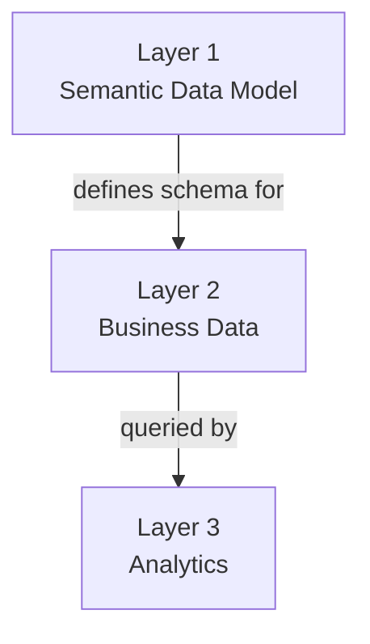

import SkillInstall from '~/components/common/SkillInstall.astro';

`use-semantius` is an **agent skill** that ships alongside the [Semantius CLI](/docs/cli). Where the CLI gives an agent the ability to call Semantius, this skill teaches the agent **how to use it well**: which layer to reach for, which tool to pick, and which mistakes to avoid.

It covers the whole of the work on a Semantius instance: building a module from a description, reviewing or changing an existing one, setting up roles and permissions, working with records, and answering analytical questions. Install it whenever you want a coding agent to operate Semantius autonomously from a shell.

## Installation

Pull the skill bundle into your agent. Leave the **Agent** dropdown on **All** to install for every detected agent, or pick a specific agent to target just that one. Toggle **Global** to install into your home directory instead of the current project.

<SkillInstall url="semantius/semantius-cli" />

Supports [OpenCode, Claude Code, Codex, Cursor, and 51 more](https://github.com/vercel-labs/skills#supported-agents). See the [skills documentation](https://github.com/vercel-labs/skills) to learn how to install skills for your agent.

## When the Skill Triggers

The skill description tells the host agent to engage it whenever a task involves the Semantius platform: building something new that needs its own records, however it is phrased (a module, an app, a tracker, "a way to see and manage X"); reviewing or auditing an existing module; creating, reading, updating or deleting entities, fields, modules, permissions, roles, users or business records; modeling kinds of one thing, such as emails and calls as kinds of activities; setting up roles and permissions; importing data; running analytical queries; linking to a record, list or module in the app; sending a transactional email; or writing shell or Bun scripts that chain `semantius` calls together.

In practice, any prompt that mentions Semantius data or schema work is enough to bring it in.

## Building and Reviewing Modules

Asked to build something that needs its own records, the agent models it on the leading products in the domain, and:

1. compares each new entity with the entities already on the instance, and asks before creating one that may hold the same thing;
2. shows you the list of entities and waits for your confirmation before the first write;
3. creates the module with its read, manage and admin permissions and its viewer, manager and admin roles, then the entities, fields and relationships, following the [Conventions](/docs/conventions);
4. adds the restricted steps and roles the work needs, such as an approval, as described in [Workflow States, Gates and Access](/docs/workflow-and-access);
5. asks whether you want sample data, and adds it only when you say yes;
6. ends with a link to the module and a summary of each role, what it can do and see, and each restricted step.

Asked to review an existing module, it reads the whole module, checks it against the same conventions, suggests what the leading products have that the module lacks, and reports. Nothing is written until you pick what to apply.

## The Three-Layer Mental Model

The single most important thing the skill teaches an agent is that Semantius is **three distinct layers**, and that each layer has its own toolset. Picking the wrong layer is the most common failure mode.



| Layer | What it covers | Tools |
| --- | --- | --- |
| **Layer 1** &nbsp;Semantic Data Model | Entities, fields, modules, relationships, RBAC | `create_entity`, `create_field`, `create_permission`, ... |
| **Layer 2** &nbsp;Business Data | Actual records in your entity tables | `postgrestRequest`, `sqlToRest` |
| **Layer 3** &nbsp;Analytics | Cross-table queries, aggregations, time series | `cube` discover, validate, load, chart |

**Rule of thumb:**

- Defining *what exists* (schema, permissions, roles): **Layer 1 typed tools**.
- Working with *actual records* in a single table: **Layer 2 `postgrestRequest`**.
- Querying *across tables* or needing *aggregations and metrics*: **Layer 3 `cube`**.

## The Two Modes

The CLI works in two modes, and the skill maps each one onto the layers above.

### `crud` mode: schema and records (Layers 1 and 2)

The typed `create_*`, `read_*`, `update_*`, `delete_*` tools manage the semantic data model itself. Alongside them, `postgrestRequest` operates on the actual rows in your business tables:

```bash
# Read records from your 'products' entity
semantius call crud postgrestRequest '{"method":"GET","path":"/products?status=eq.active&order=name.asc"}'

# Insert an order record
semantius call crud postgrestRequest '{"method":"POST","path":"/orders","body":{"customer_id":"123","total":99.99}}'

# Update matching products
semantius call crud postgrestRequest '{"method":"PATCH","path":"/products?category=eq.electronics","body":{"on_sale":true}}'
```

### `cube` mode: analytics (Layer 3)

`cube` mode speaks the CubeJS query DSL: measures, dimensions, time dimensions, filters, joins. The skill enforces one rule above all others: **always call `discover` first**. The `discover` response includes the cube schema, the complete query language reference, and the date filtering guide, so the agent never has to guess syntax.

## Golden Rules the Skill Enforces

The skill bakes in a small set of rules that prevent the most common mistakes:

1. **Read before writing.** Before any `create_*` call, run the matching `read_*` first. If a result already exists, reuse the ID instead of creating a duplicate.
2. **Schema first, in order.** Always create in the sequence Module, then Permissions, then Entity, then Fields. Never skip steps.
3. **Never recreate auto-generated fields.** `id`, `label`, `created_at`, `updated_at` and the entity's `label_column` field are created automatically by `create_entity`.
4. **`reference_table` mandates relational format.** Any field that points at another table must use `format: "reference"` (independent lifecycle) or `format: "parent"` (ownership / cascade delete).
5. **Warn before destructive changes.** Renaming `table_name` or `field_name`, deleting entities or fields: ask the user first.
6. **Link to the result.** After a schema change or a record operation, hand back a link to the app in the form `{ui_baseurl}/{module_slug}/{table_name}`, with `/{id}` added for one record, so the user can check it. `ui_baseurl` is the instance's own address, read from the signed-in user's profile, and `module_slug` is the module's lowercase slug, never its name.

## Reference Material

The skill ships with a small library of focused reference files that the agent loads on demand. Each one is scoped to a single concern:

| Reference | Purpose |
| --- | --- |
| `preflight.md` | The checks before any work: the CLI is installed and signed in, and Bun and jq are available. |
| `cli-usage.md` | CLI commands, credentials and hosts, shell patterns, chaining, installation, moving entities and modules between hosts. |
| `build-module.md` | Building something new: what it delivers, the sample-data question, verification and the final response. |
| `review-module.md` | Reviewing an existing module: what to read and check, the report, and applying what you pick. |
| `data-modeling.md` | Layer 1: modules, entities, fields, relationships, enum values and labels, safe evolution. |
| `entity-families.md` | Layer 1: subtypes and extensions (`is_a` and `has_a`). |
| `jsonlogic.md` | Layer 1: computed fields, validation rules, the extension operators, lookups across entities, `input_type_rule`. |
| `rollup-fields.md` | Layer 1: rollup fields over child records. |
| `select-rule.md` | Layer 1: which rows a user may read, with `select_rule`. |
| `rbac.md` | Layer 1: permissions, roles, user assignments, the hierarchy and restricted steps. |
| `crud-tools.md` | Layer 1 typed tools and Layer 2 `postgrestRequest` / `sqlToRest`, bulk operations, reading the audit logs. |
| `seed-data.md` | Sample records for a new module. |
| `cube-queries.md` | Layer 3: query DSL, date filtering, analysis modes. |
| `cube-tools.md` | Layer 3: `discover`, `validate`, `load`, `chart` signatures. |
| `webhooks.md` | Receiving records from external systems through signed webhook receivers. |
| `muse-questions.md`, `dot-questions.md` | How to ask questions in agents that have no question tool. |

Beside them, the skill ships scripts that the agent runs rather than reads, such as the checks every schema write goes through. The agent does not read all of the references upfront. It picks the right reference based on the task: data modeling work loads `data-modeling.md`, an analytical question loads `cube-queries.md`, and so on.

## What You Get in Practice

With `use-semantius` installed, you can hand a coding agent prompts like:

> "Build a module to track our software licenses and when they renew."

> "Orders should move through draft, confirmed, shipped and canceled, starting as draft, and only shift leads may cancel one."

> "Review the Service Desk module and tell me what it is missing."

> "List the top ten customers by total order value last quarter."

> "Import this CSV into the products table."

The agent picks the correct layer, follows the read-before-write and schema-first rules, calls the right typed tool or `postgrestRequest` or `cube` query, and reports back with the UI link to verify.

## Next Steps

- **[CLI Overview](/docs/cli)**: why the CLI exists and where it fits.
- **[The semantius command](/docs/cli/command)**: the underlying surface this skill drives.
- **[Agent Skills Overview](/docs/agent-skills)**: the other skills, `semantius-importer` for CSV files and `semantius-transfer` for moving modules between hosts.
